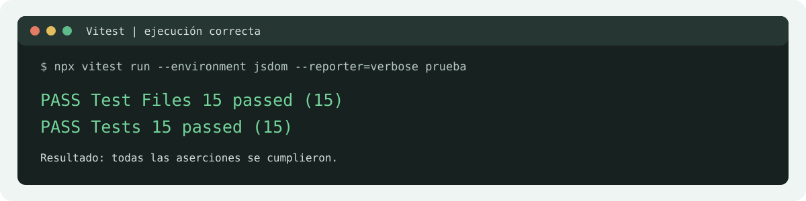
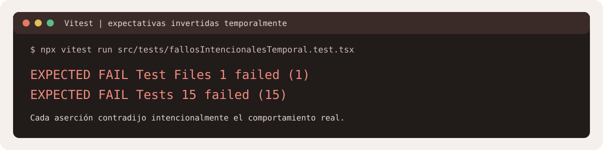

# Informe de pruebas unitarias

**Proyecto:** Veterinaria San Marcos  
**Cobertura documentada:** 15 pruebas de interfaz, catálogo, navegación y carrito.

## Objetivo

Este informe describe qué valida cada prueba, qué resultado se observó al ejecutarla correctamente y qué fallo se provocó para comprobar que la aserción detectara un resultado incorrecto.

## Ejecución

Desde la carpeta `Proyecto_veterinaria`, las 15 pruebas documentadas se ejecutan con:

```powershell
npx vitest run --environment jsdom prueba
```

Para ver los nombres y el resultado individual de las 15 pruebas:

```powershell
npx vitest run --environment jsdom --reporter=verbose prueba
```

La ejecución normal terminó con **15 pruebas aprobadas**. Para probar los fallos, se creó temporalmente una suite que invertía la expectativa de cada caso. Esa ejecución terminó con **15 pruebas fallidas**, como se esperaba. Los errores fueron discrepancias deliberadas entre la expectativa incorrecta y el resultado real; no fueron defectos de la aplicación. La suite temporal se eliminó después de generar la evidencia.

**Nota sobre `npm test`:** en el estado actual del workspace, Vitest también encuentra `src/tests/AdminPanel.test.tsx`, un archivo vacío que no pertenece a estas 15 pruebas. Por eso el comando general termina con el mensaje `No test suite found in file`. El archivo se dejó intacto; el comando anterior filtra y ejecuta exclusivamente los 15 casos de este informe.

## Evidencia

Los gráficos siguientes resumen la salida real obtenida de Vitest. El primero corresponde a la ejecución normal; el segundo, a las expectativas invertidas de la ejecución temporal.





## Descripción de las pruebas

### 1. Componentes atómicos

**Archivo:** `src/tests/prueba01ComponentesAtomicos.test.tsx`  
**Qué se prueba:** que Button y Badge muestren su texto y apliquen las clases Bootstrap recibidas en sus propiedades.  
**Resultado correcto:** Button usa `btn-success`, `btn-sm` y `me-2`; Badge usa `bg-warning` y `text-dark`.  
**Fallo provocado:** se esperaba la clase `btn-danger` para Button. Vitest informó que esa clase no estaba, porque la variante configurada era `success`.

### 2. Cantidad de productos del catálogo

**Archivo:** `src/tests/prueba02CantidadCatalogo.test.tsx`  
**Qué se prueba:** que el catálogo muestre una tarjeta por cada producto disponible en los datos.  
**Resultado correcto:** las 9 tarjetas renderizadas coinciden con los 9 productos iniciales.  
**Fallo provocado:** se esperaba una tarjeta adicional. La aserción falló porque el catálogo mostró 9 y no 10.

### 3. Búsqueda reactiva

**Archivo:** `src/tests/prueba03BusquedaCatalogo.test.tsx`  
**Qué se prueba:** que escribir `Nexgard` filtre el catálogo inmediatamente y deje solo ese producto.  
**Resultado correcto:** Nexgard permanece visible y Amoxibay deja de aparecer.  
**Fallo provocado:** se esperaba que Amoxibay siguiera visible después del filtro. La búsqueda lo quitó correctamente, por eso la expectativa invertida no se cumplió.

### 4. Estado vacío del catálogo

**Archivo:** `src/tests/prueba04EstadoVacioCatalogo.test.tsx`  
**Qué se prueba:** que una búsqueda sin coincidencias muestre un mensaje informativo y ninguna tarjeta.  
**Resultado correcto:** aparece “No hay productos que coincidan con la búsqueda.”  
**Fallo provocado:** se esperaba que el mensaje no existiera. Vitest detectó que sí estaba visible, que es el comportamiento esperado.

### 5. Subtotal y total del carrito

**Archivo:** `src/tests/prueba05TotalesCarrito.test.tsx`  
**Qué se prueba:** que el subtotal y el total cambien al aumentar la cantidad de un producto.  
**Resultado correcto:** al pasar de una a dos unidades, ambos importes se duplican.  
**Fallo provocado:** se esperaba que el total siguiera en el importe de una unidad ($4.200). La interfaz mostró el total actualizado de dos unidades ($8.400), así que la aserción incorrecta falló.

### 6. Enlaces de inicio

**Archivo:** `src/tests/prueba06EnlacesInicio.test.tsx`  
**Qué se prueba:** que los botones principales del inicio dirijan a los catálogos correctos.  
**Resultado correcto:** servicios lleva a `/servicios` y productos a `/productos`.  
**Fallo provocado:** se esperaba que el enlace de productos llevara a `/catalogo`. El destino real es `/productos`, por eso Vitest detectó la diferencia.

### 7. Filtros por categoría

**Archivo:** `src/tests/prueba07FiltrosCategoria.test.tsx`  
**Qué se prueba:** que los filtros de productos y servicios muestren solo los elementos de la categoría seleccionada.  
**Resultado correcto:** aparecen 3 productos antiparasitarios y 5 servicios de vacunación.  
**Fallo provocado:** se esperaba que la categoría de antiparasitarios mostrara 4 tarjetas. El catálogo contiene 3, y la prueba detectó el conteo incorrecto.

### 8. Agregar producto

**Archivo:** `src/tests/prueba08AgregarProducto.test.tsx`  
**Qué se prueba:** que agregar un producto desde el catálogo actualice el indicador del carrito y guarde la cantidad.  
**Resultado correcto:** el indicador muestra 1 y el artículo queda guardado con cantidad 1.  
**Fallo provocado:** se esperaba que el indicador siguiera mostrando 0. Al agregar el producto cambió a 1, por lo que Vitest señaló la expectativa errónea.

### 9. Solicitar servicio

**Archivo:** `src/tests/prueba09SolicitarServicio.test.tsx`  
**Qué se prueba:** que se pueda solicitar una reserva desde una tarjeta y verla identificada en el carrito.  
**Resultado correcto:** el carrito muestra Consulta general y la etiqueta “Solicitud de reserva”.  
**Fallo provocado:** se esperaba que la etiqueta no apareciera. El servicio sí se agregó y quedó identificado correctamente.

### 10. Quitar artículo

**Archivo:** `src/tests/prueba10QuitarArticulo.test.tsx`  
**Qué se prueba:** que quitar el único producto muestre el estado de carrito vacío y el enlace para volver al catálogo.  
**Resultado correcto:** aparece “Tu carrito está vacío”.  
**Fallo provocado:** se esperaba que ese encabezado no apareciera. El carrito cambió al estado vacío, por eso falló la expectativa invertida.

### 11. Ruta inexistente

**Archivo:** `src/tests/prueba11RutaNoEncontrada.test.tsx`  
**Qué se prueba:** que una dirección desconocida muestre la página de respaldo.  
**Resultado correcto:** se muestra “Página no encontrada”.  
**Fallo provocado:** se esperaba que el encabezado no existiera. La ruta sí presentó el fallback configurado.

### 12. Menú adaptable

**Archivo:** `src/tests/prueba12MenuNavegacion.test.tsx`  
**Qué se prueba:** que el menú de navegación abra y cierre, actualizando `aria-expanded` y la clase visual.  
**Resultado correcto:** al abrir, `aria-expanded` cambia a `true`; al cerrar, vuelve a `false`.  
**Fallo provocado:** se esperaba `false` inmediatamente después de abrirlo. El valor real fue `true`, como corresponde.

### 13. Catálogo dañado

**Archivo:** `src/tests/prueba13CatalogoDaniado.test.tsx`  
**Qué se prueba:** que la aplicación informe cuando el catálogo guardado en `localStorage` contiene JSON inválido.  
**Resultado correcto:** se muestra un aviso de error accesible.  
**Fallo provocado:** se esperaba que no hubiera aviso. La aplicación sí informó el error de datos dañados, por lo que Vitest detectó la expectativa incorrecta.

### 14. Búsqueda por código

**Archivo:** `src/tests/prueba14BusquedaPorCodigo.test.tsx`  
**Qué se prueba:** que el código del producto se pueda buscar sin distinguir mayúsculas y minúsculas.  
**Resultado correcto:** la búsqueda `me001` muestra Amoxibay 250mg como único resultado.  
**Fallo provocado:** se esperaba que no hubiera resultados. La búsqueda encontró 1 producto, por eso la aserción invertida falló.

### 15. Límite de stock

**Archivo:** `src/tests/prueba15LimiteStock.test.tsx`  
**Qué se prueba:** que no se pueda aumentar la cantidad por encima del stock disponible.  
**Resultado correcto:** con stock 1, el control para aumentar está deshabilitado y el total corresponde a una unidad.  
**Fallo provocado:** se esperaba que el control estuviera habilitado. Está deshabilitado porque el carrito ya alcanzó el stock máximo.

## Conclusión

Las 15 pruebas aprobaron al validar el comportamiento esperado. Al invertir temporalmente las expectativas, las 15 detectaron el resultado contrario y Vitest las marcó como fallidas. La suite de fallos fue temporal; el proyecto conserva únicamente las pruebas normales.